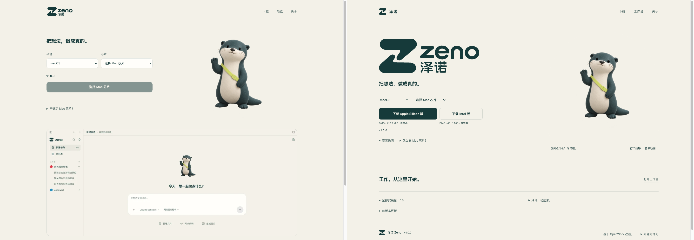
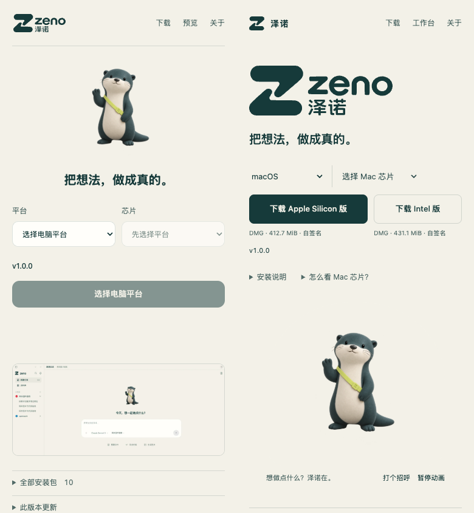
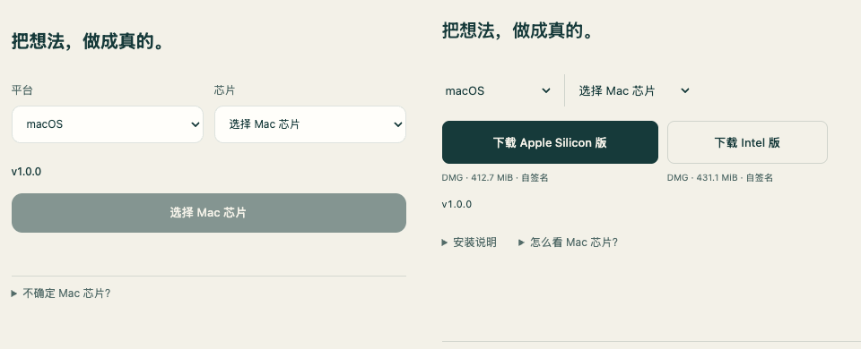

# 泽诺官网 v2 设计与交互验收

final result: passed

2026-10-16。本报告验收新版本地静态构建，不把本地通过写成线上部署完成。
12 项动效检查、10 张回归场景截图均已实际执行；8 张动效截图已逐张查看。
未发现仍需修复的 P0/P1/P2。旧版 [design-qa.md](design-qa.md) 保留原样作为历史。

## 比较范围与证据

比较基准为改版前真实官网截图和已选定的真实 Zeno 品牌资产；这是一次明确改变
构图的重设计，不是对旧官网或生成参考图的逐像素克隆。原 logo、水獭身份、
纸白/墨青/青柠保持连续，新增姿态与视频来源分别见
[静图记录](static-v2-provenance.md)、[动效记录](assets-v2-provenance.md)。

- Before：原始线上截图已复制到 [before/](verification/v2-local/before/)，
  保留 [采集状态](verification/v2-local/before/capture.json) 和
  [初次审查](verification/v2-local/before/audit.md)，未拦截当时的线上 API。
- After：本地 `build:published`，独立 Chrome target，仅该 target 的本地 API
  响应使用一次真实官网发布 JSON 的 QA 副本。标记 `fixtureOnly: true`，
  版本 1.0.0；不下载安装包、不访问系统剪贴板。
- 桌面：before/after 各为 **1440×1000 px**，CSS 视口 1440×1000，
  `deviceScaleFactor=1`；浅色、macOS、CPU 未选、下载区位于页首。
- 手机：before/after 各为 **390×844 px**，CSS 视口 390×844，密度 1。
  **状态差异：before 使用手机 UA，平台未选；after 保留 Mac UA，专门检验两条
  CPU 下载入口。** 该组合只比较排版、操作位置及可见信息，不用来声称手机
  OS 自动识别一致。已选平台/CPU 的窄屏交互另由回归脚本验证。
- 拼接保持原始像素、不缩放单侧：桌面 2880×1000，手机 780×844。下载焦点
  分别从原图裁出 480×390 后并排为 960×390，不把滚动位置差异当作间距缺陷。

下列完整图与焦点图已作为同一个图像输入实际查看，均为左旧、右新。

## 发现、修复与再次检查

| 级别与位置 | 先前证据 / 影响 | 最终修复与复验 |
| --- | --- | --- |
| P2：默认 Mac 下载区 | 旧版 CPU 未选时核心下载按钮禁用，选择像配置表单。 | 两个直接 CPU 下载入口均指向真实 API 产物；选择 CPU 后唯一主按钮指向同一产物。见桌面焦点对比及动效检查 1/3。 |
| P2：手机信息节奏 | 旧版主操作约在 y462，安装入口远离下载区，静止角色在首屏重复出现。 | 新版主操作约在 y320，安装说明紧随下载元数据；产品预览改为原生折叠行。手机 UA 不同，因此这里只比较位置和节奏，未声称完全相同状态。 |
| P2：新 CPU 快捷入口的元数据 | 初版 v2 只在 `title` 中写大小/格式/签名，手机看不到。 | 每个 CPU 操作下有可见的真实格式、MiB 和签名状态；桌面与 390px 均断言可见且不越界。见最终浅/深手机截图。 |
| P2：暗色角色背景 | 早期暗色稿有大块纸白底；普通色键草稿又误挖穿脸和腹部。未接受这些草稿为交付。 | 使用最大外轮廓填洞保护 240 帧内部，窄边羽化合成暗底；显式色彩标签消除浏览器解码色块。最终 Chrome 背景 RGB(15,38,37)，CSS 为 (16,38,38)，在两级编码容差内。首/中/尾及暗色手机重新查看，完整无明显白边。 |
| P2：暂停/重复操作连续性 | 中间实现暂停后退回静图，继续会重启片段；较早 play promise 可能暂停较新的片段。 | 暂停保留实际帧，继续从原时间推进，按钮失焦仍可达；快速重复招呼保持最新片段播放。动效检查 4/9 通过。 |

旧审查还提出“直接展示更丰富的工作成果预览”。最终采用品牌/下载为首屏焦点，
真实工作台放在明确标注的原生折叠行内，这是本轮的设计选择。截图未被虚构结果
替换，也不宣称新增了产品能力。（P1/P3/P7/S1/S3）

## 五个必查面

| 面向 | 实际检查与结论 |
| --- | --- |
| 字体与层级 | 系统中文字体；主标题 20px，正文/控件以 13px 为基础，字重提供层级。大号 Zeno 是原有 SVG 品牌资产，未用超大普通文字替代。元数据是安静小字；手机两列未发生裁切或难以辨认的换行。无外部字体。V1/P6/P7。 |
| 间距与结构 | 下载为首屏主操作，平台与 CPU 平面排列，原生折叠行承载预览、全部包和细节；单一分隔线，没有卡片套卡片。1440×1000 与 390×844 均无横向溢出。手机安装入口处于下载附近。P2/P3/S1/S3。 |
| 颜色与状态 | 纸白、墨青、青柠保持品牌语义；深色 logo 与主操作反转正确。普通状态不用错误色，缺失 API、空发布与未发布组合分别有真实状态。暗色视频实测与 CSS 背景匹配，未保留玻璃或装饰渐变。V2/V3/V7。 |
| 图像与素材 | 主 logo 使用准确原 SVG，水獭脸、耳、肩带、脚尾完整；静图 WebP 保留 PNG alpha，视频确实解码为 800² / 1280×720 并推进时间。浅/深及低动效静图均实际查看；未用 CSS 或手绘 SVG 冒充角色。P5/P10/V5。 |
| 文案与内容 | 一句产品标题，真实版本/字节换算/格式/签名，少量动作标签；安装、安全限制、hash、MIT 归属渐进展开。没有官网生日信、私人署名、官方账号诱导或假下载包。P1/P2/P3/C1/C5/C6。 |

网站采用自己的品牌展示比例，客户端原有 13px/20px 信息密度规则仍用于正文和
标题；没有把网站的放大 logo 或角色尺寸反向套入客户端。

## 实测：12 项动效与下载检查

[motion-qa.json](verification/v2-local/motion-qa.json) 为本次实际结果：
`passed: true`，12 项通过，8 张截图，0 Runtime exception。该 target 已关闭，
未触碰真实产品 tab；所有页面 HTTP(S) 请求只来自本地官网源。

1. 默认 Mac 未选 CPU：Apple Silicon / Intel 两条真实 href，主区无禁用占位按钮，
   两条大小/格式/签名元数据在当前视口可见。
2. Welcome 实际解码为 800×800，时间推进，自动播放一次后结束，没有循环。
3. 明确选择 ARM64 / Intel 后，唯一主下载 href 对应正确的真实 API 产物。
4. 打招呼、暂停、继续、再次招呼：同片段继续，当前时间不重置，暂停帧保留，
   继续按钮失焦后可达。
5. 滚出视口暂停；滚回后不再次自动播放。
6. Logo 未展开时没有 src/视频请求；原生 details 打开才设置 src，仍需显式播放，
   解码 1280×720、时间推进，关闭暂停。
7. 低动效首次加载不设置角色或 Logo src，不请求 MP4，不自动播放，显示坐姿静图。
8. 暗色 welcome/nod 均实际解码推进，使用正常合成；解码底色与 CSS 暗底一致。
9. 快速重复招呼后，最新片段继续播放，不被旧 promise 暂停。
10. 暗色低动效首次加载不设置视频 src，不请求 MP4，保留静图。
11. 390×844 浅/深无横向溢出，品牌图正常，CPU 元数据可见。
12. 无安装包请求、无 Runtime exception，无第三方 HTTP(S) 请求。

8 张图均已实际查看：

| 状态 | 实际证据 |
| --- | --- |
| 桌面自动招呼 / 默认 CPU 选择 | [01-desktop-motion](verification/v2-local/01-desktop-motion.png) |
| 桌面已选 Intel / 播放结束 | [02-desktop-rest](verification/v2-local/02-desktop-rest.png) |
| Logo 显式展开并播放 | [03-logo-explicit-playback](verification/v2-local/03-logo-explicit-playback.png) |
| 桌面浅色低动效静图 | [04-desktop-reduced-motion](verification/v2-local/04-desktop-reduced-motion.png) |
| 手机浅色 | [05-mobile-light](verification/v2-local/05-mobile-light.png) |
| 手机暗色 | [06-mobile-dark](verification/v2-local/06-mobile-dark.png) |
| 桌面暗色视频 | [07-desktop-dark-motion](verification/v2-local/07-desktop-dark-motion.png) |
| 桌面暗色低动效静图 | [08-desktop-dark-reduced-motion](verification/v2-local/08-desktop-dark-reduced-motion.png) |

## 实测：回归场景与构建回退

根任务在最后一轮执行并确认：

- `pnpm --dir apps/zeno-site check`：5 个单元测试通过，JS 语法检查通过。
- 默认 `build`：实际断言 classic 产物无 `mascotFilm`、`motion.js` 或
  `motion-v2`；随后 `build:published` 恢复显式开启的新版。
- `qa.mjs`：10 张场景截图、0 Runtime exception，独立 target 已关闭。
  [browser-qa.json](verification/v2-local/regression/browser-qa.json) 标记 fixture，
  测试包从未进入发布目录。复制成功与拒绝均为页面 stub，不改变系统剪贴板。

| 回归截图 | 覆盖的状态/动作 |
| --- | --- |
| [site-error](verification/v2-local/regression/site-error.png) | 本地真实缺失 API，真实错误/重试方向，下载无 href。 |
| [site-loading](verification/v2-local/regression/site-loading.png) | 请求进行中保留目的区域，下载不可用。 |
| [site-mac-selection](verification/v2-local/regression/site-mac-selection.png) | Mac 芯片待明确选择。 |
| [site-desktop-fixture](verification/v2-local/regression/site-desktop-fixture.png) | 已选组合、真实结构的版本/大小/格式/签名。 |
| [site-reference-viewport-fixture](verification/v2-local/regression/site-reference-viewport-fixture.png) | 1435×1058 回归视口。 |
| [site-unpublished-selection](verification/v2-local/regression/site-unpublished-selection.png) | 无该架构产物，移除 href，不能下载。 |
| [site-empty](verification/v2-local/regression/site-empty.png) | 空 artifacts 如实显示未发布。 |
| [site-narrow-fixture](verification/v2-local/regression/site-narrow-fixture.png) | 390×844 已选 Mac / Apple Silicon，无横向溢出。 |
| [site-install-narrow](verification/v2-local/regression/site-install-narrow.png) | 原生键盘展开安装说明，保留自签/系统安全方向。 |
| [site-dark-narrow-fixture](verification/v2-local/regression/site-dark-narrow-fixture.png) | 暗色低动效窄屏。 |

同轮脚本还断言：非法外站产物拒绝后可重试；按具体包选择对应 SHA；剪贴板失败
选中完整值可手动复制；原生 disclosure 可用 Enter 操作。10 指截图场景数，
不是把截图数量写成 10 个独立单元测试。

## 验收边界与后续

- 本地 QA 不证明 v2 已部署；真实线上版本、产物、HTTPS/Range/hash 与 native
  updater 由独立发布验收确认。本报告不挪用旧版线上 passed 作为新版上线证据。
- 已验原生控件键盘、可达继续按钮、浅/深与低动效；未进行完整读屏或所有系统的
  无障碍审计，也不声明 WCAG 认证。未覆盖每种缩放比例或浏览器版本。
- 手机元数据属于安静辅助信息；如后续实测需要更高可读性，可提升其字号作为 P3
  精修。没有因此阻断下载，也没有被隐藏在悬停提示中。
- 暗色视频的细毛/胡须可能在一像素边界略软，H.264 有微小量化损失；首/中/尾和
  实际页面已查看，未发现可阻断的白边、内洞或裁切。
- 无新增凭据、个人真名、客户内容或带签名资源 URL；证据只包含公开品牌、官网
  发布数据和明确命名的 fixture。原始内部生成记录不加入发布目录。

本地实现与可回退构建已验收；上线后另运行真实线上检查。
