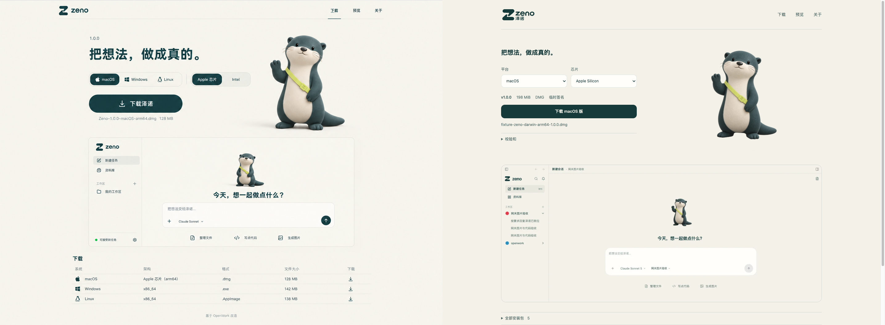
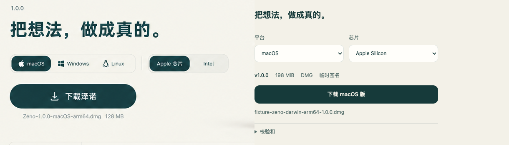
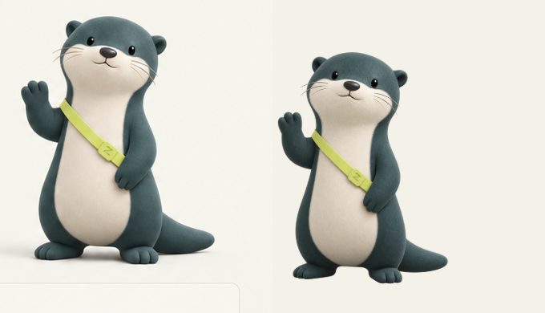
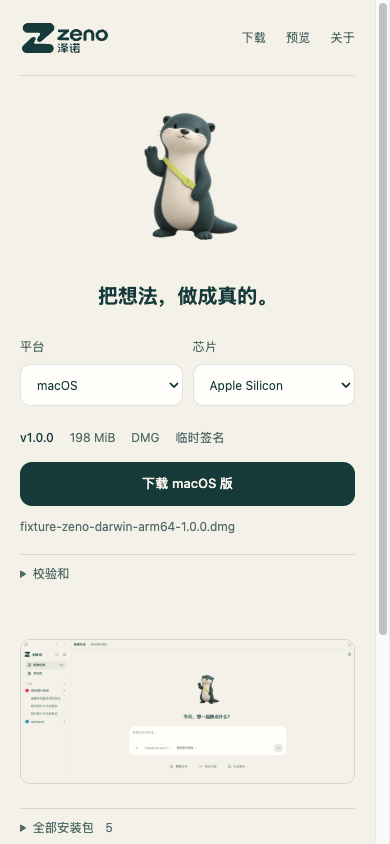
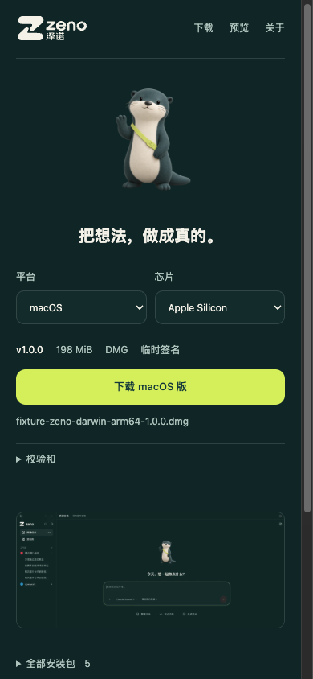

# 泽诺官网设计与交互验收

Final result: passed

验收范围：`apps/zeno-site` 本地源码、静态构建与独立 headless Chrome target。此结论表示官网实现与下述交互验收通过，不表示安装包已发布、已签名、公证或已完成真实安装。2026-10-16 检查正式域名时，首页与发布 API 尚为 404；正式发布由 operator 完成后另验。

## 参考与实际对比

已实际查看 [imagegen 概念参考](design-reference.png)，剔除其 38px 概念浏览器边框，以相同 **1435×1058** 内容视口与实际网页并排比较。图左为概念，右为实际；不缩放源图来掩盖差异。

| 必查面 | 实际实现与参考差异 | 结论 |
| --- | --- | --- |
| 字体 | 参考有放大的展示标题；实际遵循 DESIGN.md V1，正文 13px、标题 20px，系统中文字体，无外部字体请求。真实 logo 保留中文“泽诺”。 | 明确的密度调整，已通过 |
| 间距 | 1040px 主宽度、440px 下载栏、12px 控件间隙，桌面双栏、手机单栏；预览紧跟下载区。参考中始终展开的下载表变为原生 details。 | 减少首屏说明，已通过 |
| 色彩 | 纸白 `#f3f1e8`、墨青 `#163a3a`、青柠 `#d5ef5a` 均为品牌语义变量；暗色反转品牌资产，主操作用青柠。参考的渐变与额外阴影未采用。 | V4/V5/V7，已通过 |
| 图像 | 使用现有真实 logo、透明水獭与真实产品截图，未使用概念图中的虚构产品界面。预览为真实界面局部，可打开同主题完整截图；水獭桌面 240×360、手机 110×158。 | V2/V3，已通过 |
| 文案 | 一句标题、平台与芯片、真实版本/大小/格式/签名。示例图的包名、128MB 等假数据未进入源码。校验和、安装、开源说明渐进展开。无官网生日信或私人署名。 | P1/P2/P5/P10，已通过 |

原生 select 与 details 使用浏览器键盘行为；没有自制弹层、模态层或嵌套卡片。与参考的视觉差异为适配真实数据和仓库规则的设计决定，不作为逐像素克隆验收。

## 真实状态和交互

[浏览器结果](verification/browser-qa.json) 明确标记 `fixtureOnly: true`。只拦截新建 target 的本地 `5197/api/releases/latest.json`，fixture 不进入 `dist`，没有下载测试安装包、改变系统剪贴板或操作产品 app tab。完成后关闭自己的 target。零 Runtime exception；请求来源仅本地官网。

- 真实缺失 API：显示明确错误与“重新检查”；无下载 href、无虚构包列表，结束加载占位。[错误截图](verification/site-error.png)
- 请求进行中：加载占位和禁用下载。[加载截图](verification/site-loading.png)
- Mac 无法可靠判断 CPU：先选 Apple Silicon / Intel，不默认猜测。[芯片截图](verification/site-mac-selection.png)
- 已发布组合：主按钮和全部安装包均只指向 manifest 中的产物，展示实际 bytes 换算的 MiB、格式与签名。[桌面 fixture](verification/site-desktop-fixture.png)
- 不存在的平台/架构组合：移除 href 并禁用；空 artifacts 显示“安装包尚未发布”。[缺失组合](verification/site-unpublished-selection.png)、[空发布](verification/site-empty.png)
- 拒绝外站 URL、路径穿越、名称不一致、无效 hash/大小；重试可恢复。每个产物的“校验和”选择对应格式，ZIP 不误用 DMG 的 hash。
- SHA-256 / SHA-512 复制成功反馈真实；拒绝时选中完整值，提示手动复制。剪贴板成功/拒绝为页面级 stub，未写系统剪贴板。
- 原生 disclosure 可用 Enter 操作；Mac 安装帮助保留未公证/自签限制与安全检查方向，无关闭系统保护的命令。[手机展开安装](verification/site-install-narrow.png)
- 390×844 窄屏无横向溢出；暗色正确切换 logo、截图、主按钮；低动效关闭过渡。[手机](verification/site-narrow-fixture.png)、[暗色手机](verification/site-dark-narrow-fixture.png)

## 构建与边界

- `pnpm --dir apps/zeno-site check`：5 项有意义单元测试全部通过；JS 语法检查通过。
- `pnpm --dir apps/zeno-site build`：生成独立 `dist/index.html`，无新增依赖或 lockfile 变动。
- `node apps/zeno-site/scripts/qa.mjs`：10 张场景截图、0 Runtime exception，独立 target 已关闭。
- 无官方账号、Den、遥测、第三方字体/CDN、浏览器持久化或模型密钥。保留 OpenWork MIT 版权与独立许可证边界。
- 无未解决 P0/P1/P2 设计或交互问题。真实 HTTPS、安装包文件大小/hash、下载和更新 smoke 仍属于部署后验收，不能由 fixture 推定通过。

规则依据：DESIGN.md P1/P2/P3/P5/P7/P10、S1/S3、V1–V7。验证资产只含公开品牌、通用产品界面与明显命名的测试包，无凭据或客户内容。
